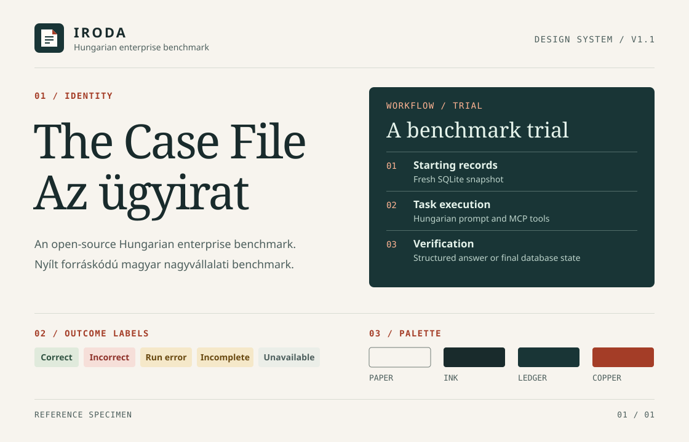

# IRODA design system · The Case File

`IRODA / DESIGN SYSTEM / v1.2`

Use this guide for new or revised IRODA web UI, documentation, benchmark reports, slides, announcements and contributor communications.

[Magyar](design-system.hu.md) · [CSS tokens](design/tokens.css) · [Mark](design/mark.svg) · [Visual specimen](design/specimen.en.svg)

**Version 1.2 · 8 November 2026** [Changelog](#07--changelog)

## 01 / Identity

IRODA is an open-source Hungarian enterprise benchmark for AI models and agents working on Hungarian-language business tasks. *Enterprise* names the audience and intended use, not the coverage, so claim only what the published cases support. The name stands for *Intelligent Reasoning for Office Decisions and Actions*. Spell it out once in introductory copy. The Case File borrows from the records the benchmark handles. Warm paper carries the narrative, ruled rows organize records, and a deep teal panel holds the evidence. Copper marks a primary action or the index of a section.

- **Use the mark with IRODA.** The folded sheet and its three rules refer to the starting records, task execution and verification. Use the supplied SVG at 32–48 px next to an uppercase sans-serif wordmark at weight 700 and .14em tracking. Keep at least one quarter of the mark’s width clear around the lockup. Use the mark alone from 24 px for favicons and avatars. Set empty alt text when the adjacent wordmark already gives the name. Do not recolor or stretch the mark, or add shadows or text to it. Its own background lets it work on light and dark surfaces.
- **Index the work.** Use compact mono labels such as `01 / RECORDS`, `02 / EXECUTION`, `03 / VERIFICATION` in an actual workflow. Open a report or major section with a thin rule and a short index such as `RESULTS / MODEL`. Use indices as wayfinding, with a descriptive title beneath.
- **Put evidence in the ledger.** Use deep teal for one focal evidence panel per major section. Use paper for the surrounding page and ruled rows for the details. Use copper for the lead action, small index labels and the mark’s fold. Give benchmark outcomes their own semantic colors.

## 02 / Foundations

Use the `--iroda-*` tokens for web work, and keep color codes out of stylesheets. For print, slides and other tools, copy the same values. Version 1.x has one light palette. The teal panel is part of it, and it is not a dark mode. [CSS tokens](design/tokens.css)

| Role | Foreground | Background |
| --- | --- | --- |
| Body and secondary text | Ink `#192B2C` (`ink`) or muted `#4C5E5C` (`muted`) | Paper `#F7F4EE` (`paper`) or surface `#FFFCF7` (`surface`) |
| Links, section indices | Copper `#A43D27` (`copper`) | Paper, surface or copper wash `#F0DED2` (`copper-wash`) |
| Primary action | White `#FFFFFF` (`on-copper`) | Copper, with hover `#80301F` (`copper-hover`) |
| Evidence panel | Mint `#E5F3EB` (`on-ledger`), muted mint `#BDD4CB` (`muted-on-ledger`), peach `#FFB493` for links and indices (`copper-on-ledger`) | Ledger `#193536` (`ledger`) |
| Rules | `#D9DCD3` for decorative separators (`rule`), `#526D6A` on the ledger (`rule-on-ledger`), `#727D77` for essential control boundaries (`control-border`) | The surface of the rule |

**Measured contrast.** The table shows the lowest value among the permitted pairs. The [tests](../tests/test_docs.py) recompute these from the tokens.

| Pair | Ratio | Requirement |
| --- | --- | --- |
| Muted on paper | 6.25:1 | 4.5:1 |
| Copper on copper wash | 4.91:1 | 4.5:1 |
| White on copper | 6.41:1 | 4.5:1 |
| Muted mint on ledger | 8.38:1 | 4.5:1 |
| Peach on ledger | 7.61:1 | 4.5:1 |
| Control border on copper wash | 3.27:1 | 3:1 |

Do not use copper on the ledger, where its contrast is only 2.04:1. Use peach instead. `rule` and `rule-on-ledger` are decorative, so do not use them for control boundaries or data.

**Type.** Use Georgia for public-facing titles and section headings at regular weight, with 1.05–1.15 line height. Use the system sans-serif for body, forms and application headings. Use tabular numerals for values that share a column. Check all fonts with “Árvíztűrő tükörfúrógép”.

| Level | Token | Size | Style |
| --- | --- | --- | --- |
| Display | `type-display` | 40–84 px | Georgia 400, line height `leading-display`, tracking `tracking-display` |
| Section heading | `type-section` | 32–56 px | Same as display |
| Small heading | `type-title` | 20 px | Sans-serif semibold |
| Body | `type-body` | 16 px | Line height `leading-body`, measure near 65 characters (`measure`) |
| Secondary | `type-small` | 14 px | Sans-serif |
| Index, version, case ID, hash, code | `type-label` | 13–14 px | Mono. Indices use weight 700, line height `leading-label`, tracking `tracking-label`. |

**Space and shape.** Work on a 4 px grid. Use 8 px within a label group (`space-2`), 16 px between controls or rows (`space-4`), 24 px inside panels (`space-5`) and 48–64 px between major sections (`space-7`, `space-8`). Use 4 px corner radii for controls and 8 px for panels. Separate surfaces with rules and fill. Cap the content shell at 72 rem. Use 16 px side gutters on narrow screens and 24 px when space allows. Stack paired content when its labels or controls start to crowd. Preserve the reading order. Use 120 ms for small color transitions and respect reduced motion.

**Accessibility.** Target WCAG 2.2 AA. Maintain 4.5:1 for ordinary text and 3:1 for large text and meaningful control boundaries against adjacent colors. Use a visible 3 px focus outline with 3 px offset, copper on light surfaces and peach on the ledger. Test keyboard order, zoom and reflow at 320 CSS px. Design standalone controls around 44 × 44 CSS px targets. Pair color with text or a shape. Label inputs, icon-only actions and data graphics. [WCAG 2.2](https://www.w3.org/TR/WCAG22/)

**Motion.** Motion shows how the benchmark works. It never decorates. The signature movements are a ruled line that draws and a row that gets checked. Keep to existing tokens, and use `motion-draw` (800 ms) for a line that draws. Play once when the element comes into view, then hold the end state, so a still frame carries the full message. Anything that moves for more than 5 seconds needs a visible pause control. With reduced motion, or without JavaScript, show a static state with the same message and no lost content. Reserve the space up front so nothing shifts. Timelines are a pure function of time and are scrubbable. Don't use looping or moving backgrounds, parallax, scroll-jacking, particles, glow or motion blur.

## 03 / UI patterns

| Pattern | Anatomy and behavior |
| --- | --- |
| Masthead | Skip link, mark, IRODA wordmark, short descriptor, navigation and text language switch. Use `lang`, `hreflang` and `aria-current` as appropriate. |
| Section header | Rule, optional mono index, sentence-case heading, one paragraph of context. One primary action per section. Leave the period off the heading. |
| Evidence panel | Index and title, one headline fact, then rows of labeled supporting details and a provenance link. Use descriptive link text with an underline. |
| Card | Surface fill, `rule` border and 24 px padding, for options of equal rank side by side, such as the two benchmark modes. |
| Fact row | Up to four real, sourced numbers in serif type above secondary copy. No illustrative or estimated figures, and include the limits too, such as the number of cases. |
| Live case file | One trial played once inside an evidence panel: the tool calls, then the grader's checks, then the outcome labels. Label it “Illustrative example”, use real tool names, and give screen readers a text summary. Never present it as a measured result. |
| Labeled rows | A definition list with ruled rows. The bold label stacks above its value on narrow screens. |
| Disclosure | Native `details` and `summary` with a descriptive label. Keep the essential content visible while closed. |
| Code block | Ledger fill, mint text, mono type and wrapping lines. It carries commands, so it does not count toward the one evidence panel per section. |
| Actions and fields | Solid copper for the primary action, an outlined neutral control for a secondary action, and an underlined link for navigation in prose. Use a persistent field label, optional help and a specific inline error. Use native buttons for operations and links for navigation. |
| Records and tables | Use real table headers and a caption. Keep identifiers copyable, align numbers right, show units in column headers and announce sorting changes. Keep wide tables in a labeled scroll region when reflow would obscure their relationships. |
| Loading, empty and failed | Say what is loading. Explain why a view is empty if known and offer the relevant next step. For failures, name what failed and give a recovery action when one exists. Preserve usable data if only part of a view fails. Announce meaningful asynchronous updates. |
| Footer | IRODA wordmark, short descriptor and a mono status label. |

Use the outcome colors as ink/fill pairs. Include the label even when an icon is present. [CSS tokens](design/tokens.css)

| Meaning | Label | Pair | Ink / fill |
| --- | --- | --- | --- |
| Grader returned `C` | Correct | `correct` | `#315443` / `#E0EADC` |
| Grader returned `I` | Incorrect | `incorrect` | `#8D3029` / `#F6DFD9` |
| Run error or unfinished trial | Run error / Incomplete | `attention` | `#68480F` / `#F5E8C9` |
| Publication or roadmap state, unavailable value | Preview / Available / Coming soon / Planned / Unavailable | `neutral` | `#4C5E5C` / `#EBEEE8` |

Keep outcome badges distinct from roadmap labels. Show “Unavailable” for a missing value and “0” for a measured zero. Preserve the underlying score and run state.

## 04 / Voice and localization

Write like a colleague handing over a record. Start with what the reader can do, what changed, or what was observed. Use concrete verbs and sentence case in Hungarian and English titles, labels and descriptors. Keep one claim per sentence when reporting results. Expand an acronym at first use for a general audience. Use `IRODA` in both languages and distinguish the project from its fictional office, Rézrigó Élelmiszer-nagykereskedelmi Kft.

| English | Magyar |
| --- | --- |
| Open-source Hungarian enterprise benchmark | Nyílt forráskódú magyar nagyvállalati benchmark |
| Model benchmark | Modellbenchmark |
| Agent benchmark | Agentbenchmark |
| Benchmark preview | A benchmark előzetese |
| View the run log | Futtatási napló megtekintése |
| The run stopped before grading. View the run log for details. | A futtatás a pontozás előtt leállt. A részleteket a futtatási naplóban találod. |
| No published results yet. | Még nincsenek közzétett eredmények. |

- Publish Hungarian and English versions of project pages, core documentation and release materials with matching claims and links to the corresponding language. In Hungarian, use natural phrasing and direct informal second person for instructions. Preserve double accents and Hungarian quotation marks („…”).
- Keep case IDs, code, machine-readable timestamps and MCP identifiers verbatim. Benchmark prompts and MCP identifiers stay Hungarian. Label any translated prompt excerpt as a translation for readers.
- Localize dates, separators and currency for display. For example, `2026. november 8.` and `1 250 Ft` in Hungarian, `8 November 2026` and `HUF 1,250` in English. Use nonbreaking grouping spaces in Hungarian and retain ISO dates in exported data.

### Glossary

Use one word per concept, so claims and published results stay comparable across languages.

| English | Magyar | Meaning and use |
| --- | --- | --- |
| enterprise benchmark, business task | nagyvállalati benchmark, üzleti feladat | The project's positioning. Keep *office* for the simulated office and the MCP tools, as in *office tools* and *office reference date*. |
| case | feladat | The benchmark unit, with a stable ID. In Hungarian, use *eset* where the text also discusses business task records or names a `kind`, as in *olvasási eset*. |
| starter case | mintafeladat | The two public cases with published expected results. |
| follow-up task, task record | követési feladat, feladatrekord | A business record in the database `feladat` table. |
| Inspect task | Inspect-feladat | `model_benchmark` or `agent_benchmark`. |
| model mode, agent mode | modellmód, agentmód | The two ways to run. Use *model benchmark* and *agent benchmark* when reporting results. |
| trial | próbálkozás | One execution of a case on a fresh database copy. Avoid *attempt*. |
| run | futtatás | A complete `inspect eval` execution. As an adjective in Hungarian, use *futtatási*: run error, log, settings. Keep *futási* for runtime things: runtime, trial database. |
| evaluation | kiértékelés | A graded run with a model, as opposed to the local tests. |
| grader | pontozó | The deterministic checker. Use *scorer* only for the Inspect API name. |
| correct, incorrect | helyes, helytelen | A graded outcome (`C`, `I`). Keep *error*, and Hungarian *hiba* and *hibás*, for run errors. |
| incomplete | befejezetlen | A trial left without a score. |
| seed | seed, kiinduló adatbázis | The versioned `data/seed.db`. In Hungarian, write *kiinduló adatbázis (seed)* at first use. |
| hash | lenyomat | A SHA-256 value. A Docker image *digest* keeps its name. |
| reference date | fordulónap | The office's simulated current date. |
| agent, reference agent | agent, referencia-agent | Hungarian text does not translate this as *ügynök*. |
| read tool, write tool | olvasóeszköz, íróeszköz | MCP tools. For modes, use read-only mode and writable session. |

## 05 / Reports and communications

| Material | Structure |
| --- | --- |
| README or docs | One-sentence purpose, status, runnable next step and related references. Prefer selectable code and short headings. |
| Release note, announcement or email | Name the release or change in the title. Open with the reader-facing change, state its scope, then give one next action. Link to the release or supporting artifact. In email, put key text in the message body. |
| Slides, social cards and print | Use the mark, a short index, a serif title and one figure or evidence block. Add the version or source below the figure. Include the claim and key figures in surrounding text or alt text when exporting an image. |
| Results page or report | Lead with what ran and what was scored. Separate model and agent modes. Show eligible denominators, scored counts, errors and incomplete trials. Include case/seed versions, exact model and agent configuration, date and a reproducibility link. Follow the [measurement methodology](methodology.en.md). |

Use directly labeled horizontal bars or a compact table for comparisons. Start bar axes at zero. Show counts alongside percentages, identify the denominator and distinguish missing trials from incorrect answers. Use the same scale for comparable panels, and add accessible text or a table with the same values. Mark specimen data as illustrative. Describe the coverage of public starter cases before drawing conclusions about performance.

**Chart colors.** Use ledger for a single series and copper for the highlighted value. For an outcome breakdown, use the outcome ink colors and separate adjacent segments with a 2 px paper gap, because those colors are hard to tell apart from each other. Show model and agent modes in separate panels rather than separating them by color. Give every segment a direct text label.

### Copy examples

**Release announcement**

> **IRODA benchmark preview**
>
> Run two public starter cases against a simulated Hungarian office. One checks a structured answer. The other checks whether the agent creates the requested follow-up without changing existing records.
>
> Run the starter cases.

Link the final line to the run guide. For a social card, keep the title and the first sentence on the card and put the scope and link in the post.

**Run summary**

> **MODEL / STARTER CASES · ILLUSTRATIVE**
>
> Of 10 scheduled trials, 8 received a score. Six were correct and two were incorrect, for 75% accuracy among scored trials. One trial ended in a run error and one was incomplete.

Follow the summary with case-level results and the run configuration. Name the denominator beside the metric wherever it appears.

### Markdown

Use the Case File structure in plain Markdown. The renderer supplies the palette and typography, including GitHub's dark mode, so use readable text labels for all states and do not rely on background color. Keep heading anchors stable when reformatting existing documents.

Open every document with these items, in this order:

1. The heading. On the project README, the supplied mark sits above it, and the project name and headline stay selectable text.
2. A short mono document label, such as `IRODA / METHODOLOGY`. Versioned material includes the version: `IRODA / DATASET / v0.1.0`.
3. One sentence on what the document is for.
4. A link row: the language counterpart first, then related documents, separated by ` · `.

| Element | Rule |
| --- | --- |
| Language pairs | Name standalone documents `name.hu.md` and `name.en.md`. The exceptions are `README.md` (Hungarian) with `README.en.md`, and `ADATLEIRAS.md` with `DATASET.md`. `CONTRIBUTING.md` and `AGENTS.md` carry both languages in one file, with the Hungarian part under `## Magyar`, including its own label and the commands. |
| Code block | Use a `~~~sh` fence with a language tag. Include only the command, without printed output or `$`. Mark values to fill in with a descriptive placeholder. |
| Source link | Put it at the end of the paragraph as standalone text: `[Measurement methodology](methodology.en.md)`. Separate several links with ` · `. |
| Prompt excerpt | Use a labeled quotation with a link to the source. Mark English text as a translation. |
| Checks and outcomes | Use a table with text status labels. |

## 06 / Applying and changing the system

1. Start from this guide and the supplied assets. Both homepage languages load the same tokens and mark from `site/dist/`. After updating the canonical assets, refresh the deployed copies from the repository root with `cp docs/design/tokens.css docs/design/mark.svg site/dist/`. Keep `tokens.css` before `style.css` on both pages.
2. Review the smallest and widest layouts, long Hungarian labels, focus order, reduced motion, all relevant UI states and any exported or printed version. Verify that labels and claims agree across languages. `uv run --locked pytest tests/test_docs.py` checks the contrast pairs, document structure, language pair parity, relative links and the token copy.
3. Update both guides, the relevant token or asset, and the changelog in the same change when introducing a shared rule. A new rule or token raises the minor version. Raise the major version when an existing token's value or meaning changes in a way that requires reworking earlier material. Keep versioned reports traceable to their benchmark configuration and design-system version.

## 07 / Changelog

| Version | Date | Change |
| --- | --- | --- |
| 1.2 | 8 November 2026 | Motion rules, live case file pattern and the `motion-draw` token. |
| 1.1 | 8 November 2026 | Glossary, document structure and language pair rules. Token names, measured contrast, chart colors and new UI patterns. New tokens: `rule-on-ledger`, `leading-*`, `tracking-*`. Bilingual specimen and automated checks. Enterprise positioning, fact row. |
| 1.0 | 8 November 2026 | First release. |
