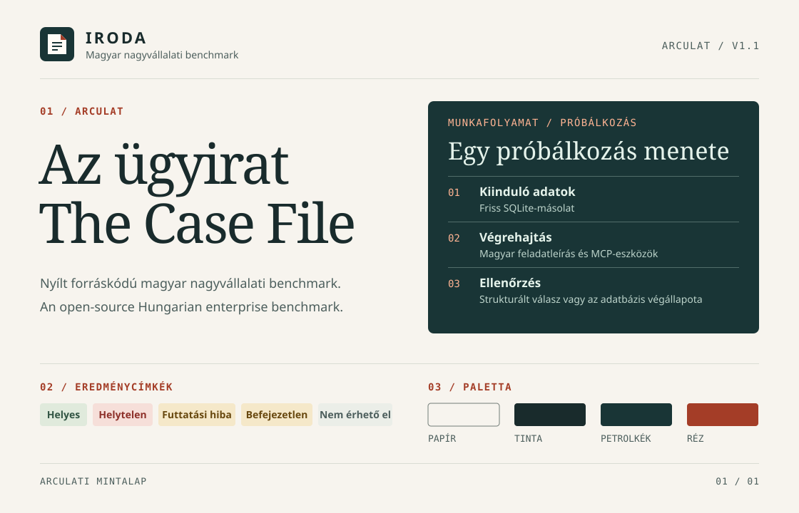

# IRODA arculati és stílusútmutató · Az ügyirat

`IRODA / ARCULAT / v1.2`

Használd ezt az útmutatót az IRODA új és frissített webes felületeihez, dokumentációjához, mérési jelentéseihez, prezentációihoz, közleményeihez és a közreműködőknek szóló anyagokhoz.

[English](design-system.en.md) · [CSS-tokenek](design/tokens.css) · [Jel](design/mark.svg) · [Arculati mintalap](design/specimen.hu.svg)

**1.2-es verzió · 2026. november 8.** [Változásnapló](#07--változásnapló)

## 01 / Arculat

Az IRODA nyílt forráskódú magyar nagyvállalati benchmark AI-modellek és agentek mérésére magyar nyelvű üzleti feladatokon. A *nagyvállalati* szó a célközönséget és a felhasználást jelöli, nem a lefedettséget: az eredményekből csak annyit állíts, amennyit a közölt feladatok alátámasztanak. A név feloldása *Intelligent Reasoning for Office Decisions and Actions*. Ezt elég a bemutatkozó szövegben egyszer kiírni. Az arculat az irodai ügyiratokból indul ki. A meleg papírszínen olvasható a szöveg, a vonalazott sorok rendszerezik a rekordokat, a sötét petrolkék panel pedig a mérés adatait emeli ki. A rézszín a fő műveletet vagy a szakasz jelölését mutatja.

- **A jelet az IRODA névvel használd.** A behajtott sarkú lap három vonala a kiinduló adatokra, a végrehajtásra és az ellenőrzésre utal. A mellékelt SVG 32–48 px méretben kerüljön a nagybetűs, talpatlan, 700-as vastagságú és .14em betűközű IRODA felirat mellé. A két elem körül hagyj legalább a jel szélességének negyedével megegyező szabad helyet. Webhelyikonként és profilképként 24 px-től önállóan is használd. Ha a szomszédos felirat már megadja a nevet, a kép alternatív szövege legyen üres. A jelet ne színezd át, ne nyújtsd el, és ne tegyél rá árnyékot vagy szöveget. Saját hátterével világos és sötét felületen is használható.
- **Jelöld a munkafolyamat lépéseit.** Használj rövid, fix szélességű címkéket, például `01 / KIINDULÓ ADATOK`, `02 / VÉGREHAJTÁS` és `03 / ELLENŐRZÉS`. A jelentés vagy fő szakasz élére kerüljön vékony vonal és rövid jelölés, például `EREDMÉNYEK / MODELL`, alá pedig beszédes cím.
- **Emeld ki a mérési adatokat.** Fő szakaszonként egy sötét petrolkék panelt használj az adatok kiemelésére. A környező felület legyen papírszínű, a részletek kerüljenek vonalazott sorokba. A rézszínt a fő műveletnél, a rövid szakaszcímkéken és a jel behajtott sarkán használd. A benchmark eredményállapotai külön színpárokat kapnak.

## 02 / Alapok

A weben használd a `--iroda-*` tokeneket, és ne írj színkódot a stíluslapba. Nyomtatáshoz, diákhoz és egyéb eszközökben vedd át ugyanezeket az értékeket. Az 1.x verziókban egyetlen, világos paletta van. A petrolkék panel ennek része, nem sötét mód. [CSS-tokenek](design/tokens.css)

| Szerep | Előtér | Háttér |
| --- | --- | --- |
| Törzsszöveg és másodlagos szöveg | Tinta `#192B2C` (`ink`) vagy tompa tinta `#4C5E5C` (`muted`) | Papír `#F7F4EE` (`paper`) vagy világos felület `#FFFCF7` (`surface`) |
| Hivatkozások, szakaszjelölések | Réz `#A43D27` (`copper`) | Papír, világos felület vagy halvány réz `#F0DED2` (`copper-wash`) |
| Fő művelet | Fehér `#FFFFFF` (`on-copper`) | Réz, rámutatáskor `#80301F` (`copper-hover`) |
| Mérési panel | Menta `#E5F3EB` (`on-ledger`), tompa menta `#BDD4CB` (`muted-on-ledger`), a linkekhez és jelölésekhez barack `#FFB493` (`copper-on-ledger`) | Petrolkék `#193536` (`ledger`) |
| Vonalak | Díszítő elválasztó `#D9DCD3` (`rule`), panelen `#526D6A` (`rule-on-ledger`), a vezérlők felismeréséhez szükséges keret `#727D77` (`control-border`) | A vonal felülete |

**Mért kontraszt.** A táblázat a megengedett párok legkisebb értékét mutatja. A [tesztek](../tests/test_docs.py) ezeket a tokenekből számolják újra.

| Pár | Arány | Követelmény |
| --- | --- | --- |
| Tompa tinta a papíron | 6,25:1 | 4,5:1 |
| Réz a halvány rézen | 4,91:1 | 4,5:1 |
| Fehér a rézen | 6,41:1 | 4,5:1 |
| Tompa menta a petrolkéken | 8,38:1 | 4,5:1 |
| Barack a petrolkéken | 7,61:1 | 4,5:1 |
| Vezérlőkeret a halvány rézen | 3,27:1 | 3:1 |

Petrolkék felületen ne használj rezet, mert a kontrasztja csak 2,04:1. Helyette barackot használj. A `rule` és a `rule-on-ledger` díszítő vonal, vezérlő határa vagy adat nem lehet.

**Tipográfia.** A nyilvános anyagok főcímeihez és szakaszcímeihez használj normál vastagságú Georgiát, 1,05–1,15 sormagassággal. A törzsszöveghez, űrlapokhoz és alkalmazáscímekhez használd a rendszer talpatlan betűtípusát. Azonos oszlopban azonos szélességű számjegyeket használj. A betűtípusokat az „Árvíztűrő tükörfúrógép” szöveggel ellenőrizd.

| Szint | Token | Méret | Stílus |
| --- | --- | --- | --- |
| Főcím | `type-display` | 40–84 px | Georgia 400, sormagasság `leading-display`, betűköz `tracking-display` |
| Szakaszcím | `type-section` | 32–56 px | Mint a főcím |
| Kisebb cím | `type-title` | 20 px | Talpatlan, félkövér |
| Törzsszöveg | `type-body` | 16 px | Sormagasság `leading-body`, soronként körülbelül 65 karakter (`measure`) |
| Másodlagos szöveg | `type-small` | 14 px | Talpatlan |
| Jelölés, verzió, feladatazonosító, lenyomat, kód | `type-label` | 13–14 px | Fix szélességű. A jelölés 700-as, sormagasság `leading-label`, betűköz `tracking-label`. |

**Térköz és forma.** Dolgozz 4 px-es rácson. A címkék között használj 8 px-t (`space-2`), a vezérlők vagy sorok között 16 px-t (`space-4`), a panelek belsejében 24 px-t (`space-5`), a fő szakaszok között pedig 48–64 px-t (`space-7`, `space-8`). A vezérlők sarkainál 4 px, a paneleknél 8 px a lekerekítés. A felületeket vonal és háttérszín válassza el. A tartalmi sáv legfeljebb 72 rem széles. Keskeny kijelzőn hagyj 16 px, tágasabb nézetben 24 px oldalmargót. Ha a címkék vagy vezérlők összeszorulnak, helyezd a párhuzamos blokkokat egymás alá az olvasási sorrend megőrzésével. A finom színátmenetek 120 ms hosszúak, a csökkentett mozgásra vonatkozó beállítást figyelembe kell venni.

**Akadálymentesség.** A cél a WCAG 2.2 AA. A normál szöveg kontrasztja legalább 4,5:1 legyen, a nagy szövegé és a vezérlők fontos határvonalaié legalább 3:1 a szomszédos színekhez képest. A fókuszjelző 3 px vastag, 3 px távolságra a vezérlőtől, világos felületen réz, petrolkék felületen barack színű. Ellenőrizd a billentyűzetes sorrendet, a nagyítást és a tördelést 320 CSS px szélességen. Az önálló vezérlőkhöz tervezz 44 × 44 CSS px-es célterületet. A szín mellé adj szöveget vagy alakjelet. Címkézd a mezőket, az ikonból álló műveleteket és az adatábrákat. [WCAG 2.2](https://www.w3.org/TR/WCAG22/)

**Mozgás.** A mozgás a benchmark működését mutatja, díszítésre nem használjuk. A jellegzetes mozdulat a kirajzolódó vonal és a kipipált sor. Csak a meglévő tokeneket használd, a kirajzolódó vonalhoz a `motion-draw` (800 ms) értéket. Az animáció egyszer fusson le, amikor az elem láthatóvá válik, majd a végállapot maradjon a képernyőn, így egy állókép is hordozza a teljes üzenetet. Ami 5 másodpercnél tovább mozog, annak látható szüneteltető vezérlő kell. Csökkentett mozgásnál vagy JavaScript nélkül statikus állapot jelenjen meg ugyanazzal az üzenettel, tartalomvesztés nélkül. Előre foglald le a helyet, hogy semmi ne ugorjon el. Az idővonal az idő tiszta függvénye, ezért visszatekerhető. Ne használj ismétlődő vagy mozgó hátteret, parallaxist, görgetést átvevő hatást, részecskéket, ragyogást vagy mozgási elmosódást.

## 03 / Felületi minták

| Minta | Felépítés és működés |
| --- | --- |
| Fejléc | Ugrólink a tartalomra, jel, IRODA felirat, rövid leírás, navigáció és szöveges nyelvváltó. Használd a megfelelő `lang`, `hreflang` és `aria-current` attribútumokat. |
| Szakaszfejléc | Vonal, opcionális fix szélességű jelölés, mondatkezdő nagybetűs cím és egy bekezdésnyi kontextus. Szakaszonként egy fő művelet. A cím végére ne tegyél pontot. |
| Mérési panel | Jelölés és cím, egy kiemelt tény, majd címkézett sorok a részleteknek és hivatkozás a forrásra. A link szövege legyen beszédes és aláhúzott. |
| Kártya | Világos felület, `rule` keret és 24 px belső margó, azonos rangú lehetőségek egymás mellé rendeléséhez, például a két benchmarkmódhoz. |
| Tényszámsor | Legfeljebb négy valós, forrással igazolható szám talpas betűvel, alatta másodlagos szöveggel. Szemléltető vagy becsült számot nem tartalmazhat, és a korlátokat is mutassa, például a feladatok számát. |
| Élő ügyirat | Egy próbálkozás egyszeri lejátszása mérési panelen belül: az eszközhívások, a pontozó ellenőrzései, majd az eredménycímkék. „Szemléltető példa” felirat kell hozzá, valódi eszköznevekkel és szöveges összefoglalóval a képernyőolvasóknak. Soha ne tüntesd fel mért eredményként. |
| Címkézett sorok | Definíciós lista vonalazott sorokkal. A félkövér címke keskeny nézetben az érték fölé kerül. |
| Lenyitható részlet | Natív `details` és `summary`, beszédes felirattal. A lényeg zárt állapotban is legyen látható. |
| Kódblokk | Petrolkék háttér, menta szöveg, fix szélességű betű, tördelhető sorok. Parancsot közöl, ezért nem számít bele a szakaszonkénti egy mérési panelbe. |
| Műveletek és mezők | Réz hátterű fő művelet, semleges keretes másodlagos vezérlő, a folyószövegben aláhúzott link. A mezőhöz állandó címke, szükség esetén súgó és konkrét hibaüzenet tartozik. Művelethez natív gombot, navigációhoz linket használj. |
| Rekordok és táblázatok | Használj valódi oszlopfejléceket és táblázatcímet. Az azonosítók legyenek másolhatók, a számok jobbra igazítottak, a mértékegység az oszlopfejlécben szerepeljen. Jelezd a rendezés változását. Ha a tördelés elrejtené az összefüggéseket, tedd a széles táblázatot elnevezett, görgethető területre. |
| Betöltés, üres állapot és hiba | Nevezd meg, mi töltődik be. Üres nézetnél írd le az okot, ha ismert, és adj meg egy következő lépést. Hibánál mondd meg, mi hiúsult meg, és hogyan lehet folytatni, ha erre van mód. Részleges hiba esetén tartsd meg a használható adatokat. Jelezd a fontos aszinkron változásokat. |
| Lábléc | IRODA felirat, rövid leírás és fix szélességű állapotjelölés. |

Az eredménycímkékhez a tokenek összetartozó előtér- és háttérszíneit használd. Az ikon mellé is kerüljön szöveges címke. [CSS-tokenek](design/tokens.css)

| Jelentés | Címke | Színpár | Előtér / háttér |
| --- | --- | --- | --- |
| A pontozó `C` értéket adott | Helyes | `correct` | `#315443` / `#E0EADC` |
| A pontozó `I` értéket adott | Helytelen | `incorrect` | `#8D3029` / `#F6DFD9` |
| Futtatási hiba vagy befejezetlen próbálkozás | Futtatási hiba / Befejezetlen | `attention` | `#68480F` / `#F5E8C9` |
| Közzétételi vagy ütemtervi állapot, hiányzó érték | Előzetes / Elérhető / Hamarosan / Tervezett / Nem érhető el | `neutral` | `#4C5E5C` / `#EBEEE8` |

Az eredményállapotokat különítsd el az ütemterv címkéitől. Hiányzó értéknél a „Nem érhető el” címkét, mért nullánál a „0” értéket jelenítsd meg. Őrizd meg a pontozó eredeti értékét és a futtatás állapotát.

## 04 / Hangnem és lokalizáció

Úgy írj, mintha egy kollégának adnál át egy ügyiratot. Azzal kezdd, mit tehet az olvasó, mi változott, vagy mit figyeltünk meg. Használj konkrét igéket és mondatkezdő nagybetűt, a magyar és az angol címekben, feliratokban és leírásokban is. Az eredmények leírásában mondatonként egy állítást tegyél. Az általános közönségnek szóló anyagokban első előforduláskor oldd fel a rövidítéseket. A projekt neve mindkét nyelven `IRODA`. A fiktív vállalat neve Rézrigó Élelmiszer-nagykereskedelmi Kft.

| Magyar | English |
| --- | --- |
| Nyílt forráskódú magyar nagyvállalati benchmark | Open-source Hungarian enterprise benchmark |
| Modellbenchmark | Model benchmark |
| Agentbenchmark | Agent benchmark |
| A benchmark előzetese | Benchmark preview |
| Futtatási napló megtekintése | View the run log |
| A futtatás a pontozás előtt leállt. A részleteket a futtatási naplóban találod. | The run stopped before grading. View the run log for details. |
| Még nincsenek közzétett eredmények. | No published results yet. |

- A projektoldalakat, az alapvető dokumentációt és a kiadási anyagokat magyarul és angolul is tedd közzé, azonos állításokkal és a megfelelő nyelvi párra mutató linkekkel. Magyarul fogalmazz természetesen, az útmutatókban tegező formában. Őrizd meg az ékezeteket és a magyar idézőjelet („…”).
- A feladatazonosítókat, a kódot, a gépi időbélyegeket és az MCP-azonosítókat változatlanul közöld. A benchmark promptjai és az MCP-azonosítók magyarul maradnak. A prompt fordítását jelöld az olvasóknak.
- Megjelenítéskor igazítsd a dátumot, az elválasztókat és a pénznemet a nyelvhez. Példa magyarul `2026. november 8.` és `1 250 Ft`, angolul `8 November 2026` és `HUF 1,250`. A magyar számcsoportokat nem törhető szóköz válassza el, az exportált dátum maradjon ISO-formátumú.

### Szójegyzék

Egy fogalomra mindig ugyanazt a szót használd, hogy a két nyelv állításai és a közölt eredmények összevethetők maradjanak.

| Magyar | English | Jelentés és használat |
| --- | --- | --- |
| nagyvállalati benchmark, üzleti feladat | enterprise benchmark, business task | A projekt pozicionálása. Az *irodai* szót tartsd meg a szimulált irodára és az MCP-eszközökre, például *irodai eszközök*, *irodai fordulónap*. |
| feladat | case | A benchmark egysége, stabil azonosítóval. Ahol a szöveg üzleti feladatrekordról is szól, vagy a `kind` típusát nevezi meg, használd az *eset* szót, például *olvasási eset*. |
| mintafeladat | starter case | A két nyilvános, közzétett elvárt eredményű feladat. |
| követési feladat, feladatrekord | follow-up task, task record | Üzleti rekord az adatbázis `feladat` táblájában. |
| Inspect-feladat | Inspect task | `model_benchmark` vagy `agent_benchmark`. |
| modellmód, agentmód | model mode, agent mode | A két futtatási mód. Az eredmények közlésekor *modellbenchmark* és *agentbenchmark*. |
| próbálkozás | trial | Egy feladat egyszeri végrehajtása friss adatbázis-másolaton. |
| futtatás | run | Egy `inspect eval` parancs teljes végrehajtása. Jelzőként *futtatási*: futtatási hiba, napló, beállítás. A *futási* szó csak a futásidejű dolgokra való: futási idő, futási adatbázis. |
| kiértékelés | evaluation | Modellel végzett, pontozott futtatás, szemben a helyi tesztekkel. |
| pontozó | grader | A determinisztikus ellenőrző. A *scorer* szót csak az Inspect API nevében használd. |
| helyes, helytelen | correct, incorrect | Pontozott eredmény (`C`, `I`). A *hiba* és a *hibás* szót, angolul az *error* szót tartsd fenn a futtatási hibákra. |
| befejezetlen | incomplete | Pontszám nélkül maradt próbálkozás. |
| seed, kiinduló adatbázis | seed | A verziózott `data/seed.db`. Első előforduláskor írd ki: *kiinduló adatbázis (seed)*. |
| lenyomat | hash | SHA-256 érték. A Docker-image *digest* neve kivétel. |
| fordulónap | reference date | Az iroda szimulált mai napja. |
| agent, referencia-agent | agent, reference agent | Nem fordítjuk *ügynöknek*. |
| olvasóeszköz, íróeszköz | read tool, write tool | MCP-eszközök. Módként: olvasási mód, írható munkamenet. |

## 05 / Jelentések és kommunikáció

| Anyag | Felépítés |
| --- | --- |
| README vagy dokumentáció | Egymondatos cél, állapot, futtatható következő lépés és kapcsolódó hivatkozások. A kód legyen kijelölhető, a címek rövidek. |
| Kiadási jegyzet, közlemény vagy e-mail | A cím nevezze meg a kiadást vagy változást. Kezdd azzal, mi változott az olvasó számára, add meg a változás hatókörét, majd egy következő lépést. Hivatkozz a kiadásra vagy az alapjául szolgáló anyagra. E-mailben a lényeg az üzenet törzsébe kerüljön. |
| Dia, közösségi kártya és nyomtatott anyag | Használj jelet, rövid szakaszjelölést, talpas címet és egy ábrát vagy mérési blokkot. Az ábra alatt szerepeljen a verzió vagy forrás. Képként exportálva az állítás és a fő számok a kísérőszövegben vagy az alternatív szövegben is szerepeljenek. |
| Eredményoldal vagy jelentés | Kezdd azzal, mit futtattunk és mit pontoztunk. Különítsd el a modell- és agentmódot. Tüntesd fel az arányok nevezőjét, a pontozott próbálkozások, a hibák és a befejezetlen futások számát. Add meg a feladatkészlet és a seed verzióját, a pontos modell- és agentbeállításokat, a dátumot és a reprodukáláshoz szükséges hivatkozást. [Mérési módszertan](methodology.hu.md) |

Összehasonlításhoz használj közvetlenül feliratozott vízszintes sávokat vagy tömör táblázatot. A sávdiagram tengelye nulláról induljon. A százalék mellett szerepeljen a darabszám és a nevező. Különítsd el a hiányzó próbálkozást a helytelen választól. Az összevethető panelek azonos skálát kapjanak, az értékek szövegben vagy táblázatban is elérhetők legyenek. A példaadatokat jelöld szemléltető adatként. A teljesítmény értékelése előtt írd le, mit fednek le a nyilvános mintafeladatok.

**Ábraszínek.** Egy adatsornál használj petrolkék sávot, a kiemelt értékhez pedig rezet. Az eredmények megoszlásánál az eredménycímkék előtérszíneit használd, és a szomszédos szakaszokat 2 px-es papírszínű rés válassza el, mert ezek a színek egymástól nehezen különböznek. A modell- és agentmódot külön panelben mutasd, ne színnel különítsd el. Minden szakasz kapjon közvetlen szöveges címkét.

### Szövegminták

**Kiadási közlemény**

> **Az IRODA benchmark előzetese**
>
> Futtass két nyilvános mintafeladatot egy szimulált magyar irodában. Az egyik strukturált választ ellenőriz. A másik azt vizsgálja, hogy az agent létrehozza-e a kért követési feladatot a meglévő rekordok módosítása nélkül.
>
> Futtasd a mintafeladatokat.

Az utolsó sor a futtatási útmutatóra mutasson. Közösségi kártyán a cím és az első mondat szerepeljen, a hatókör és a link a bejegyzés szövegébe kerüljön.

**Futtatási összefoglaló**

> **MODELL / MINTAFELADATOK · SZEMLÉLTETŐ ADATOK**
>
> A 10 tervezett próbálkozásból 8 kapott pontszámot. Hat helyes és kettő helytelen volt, így a pontozott próbálkozások 75%-a volt helyes. Egy próbálkozás futtatási hibával zárult, egy pedig befejezetlen maradt.

Az összefoglaló után közöld a feladatonkénti eredményeket és a futtatás beállításait. Az arányszám mellett mindenhol nevezd meg a nevezőt.

### Markdown

Markdownban az ügyirat szerkezetét használd. A színeket és a tipográfiát a megjelenítő adja, a GitHub sötét módban is, ezért minden állapothoz használj olvasható szöveges címkét, és ne építs a háttérszínre. Meglévő dokumentum újraformázásakor tartsd meg a címsorok hivatkozási azonosítóit.

Minden dokumentum így kezdődik, ebben a sorrendben:

1. A címsor. A projekt README-jében fölötte a mellékelt jel áll, a projektnév és a főcím pedig kijelölhető szöveg marad.
2. Rövid, fix szélességű dokumentumjelölés, például `IRODA / MÓDSZERTAN`. Verziózott anyagnál a verzió is bekerül: `IRODA / ADATKÉSZLET / v0.1.0`.
3. Egy mondat arról, mire jó a dokumentum.
4. Linksor: a másik nyelvi változat első helyen, utána a kapcsolódó dokumentumok, ` · ` elválasztóval.

| Elem | Szabály |
| --- | --- |
| Nyelvi párok | Önálló dokumentumnál `név.hu.md` és `név.en.md`. Kivétel a `README.md` (magyar) és `README.en.md`, valamint az `ADATLEIRAS.md` és `DATASET.md`. A `CONTRIBUTING.md` és az `AGENTS.md` egy fájlban hordozza a két nyelvet, a magyar rész `## Magyar` alatt áll, saját jelöléssel és a parancsokkal együtt. |
| Kódblokk | `~~~sh` kerítéssel, nyelvi jelöléssel, és csak a parancsot tartalmazza, kiírt kimenet és `$` nélkül. A kitöltendő értéket beszédes helyőrzővel jelöld. |
| Forráslink | A bekezdés végén, önálló szövegként: `[Mérési módszertan](methodology.hu.md)`. Több link ` · ` elválasztóval követi egymást. |
| Promptrészlet | Jelölt idézetben, a forrásra mutató linkkel. Angol szövegben jelöld, hogy fordítás. |
| Ellenőrzés és eredmény | Táblázatban, szöveges állapotcímkével. |

## 06 / Használat és változtatás

1. Indulj ebből az útmutatóból és a mellékelt arculati elemekből. A kezdőlap két nyelvi változata ugyanazokat a tokeneket és ugyanazt a jelet tölti be a `site/dist/` mappából. A központi fájlok módosítása után a repó gyökeréből futtasd a `cp docs/design/tokens.css docs/design/mark.svg site/dist/` parancsot. Mindkét oldalon a `tokens.css` kerüljön a `style.css` elé.
2. Ellenőrizd a legkeskenyebb és legtágasabb nézetet, a hosszú magyar címkéket, a fókuszsorrendet, a csökkentett mozgást, a fontos felületi állapotokat és az exportált vagy nyomtatott anyagot. A két nyelv állításai és címkéi egyezzenek. Az `uv run --locked pytest tests/test_docs.py` parancs ellenőrzi a kontrasztpárokat, a dokumentumok felépítését, a nyelvi párok egyezését, a relatív linkeket és a tokenek másolatát.
3. Új közös szabály bevezetésekor ugyanabban a módosításban frissítsd mindkét útmutatót, az érintett tokent vagy arculati elemet és a változásnaplót. Új szabály vagy token a kisebb verziószámot növeli. A nagyobb verziószám akkor nő, ha meglévő token értéke vagy jelentése úgy változik, hogy a korábbi anyagokat is át kell dolgozni. A verziózott jelentések alapján azonosítható maradjon a futtatás konfigurációja és az arculati rendszer verziója.

## 07 / Változásnapló

| Verzió | Dátum | Változás |
| --- | --- | --- |
| 1.2 | 2026. november 8. | Mozgási szabályok, élő ügyirat minta és a `motion-draw` token. |
| 1.1 | 2026. november 8. | Szójegyzék, dokumentumfelépítés és nyelvi párok szabályai. Tokennevek, mért kontrasztok, ábraszínek, új felületi minták. Új tokenek: `rule-on-ledger`, `leading-*`, `tracking-*`. Kétnyelvű mintalap és automatikus ellenőrzés. Nagyvállalati pozicionálás, tényszámsor. |
| 1.0 | 2026. november 8. | Első kiadás. |
